# chrome-extensions

個人的 Chrome extension（Manifest V3）。目前有：

- `catworld-auto-command`：小貓的世界自動指令，遇到驗證碼自動停止並提醒。版本紀錄見 [CHANGELOG.md](CHANGELOG.md)。

## 安裝（不需要 Node / git）

Windows 打開 PowerShell，貼上：

```powershell
irm https://raw.githubusercontent.com/austinchen705/chrome-extensions/main/install.ps1 | iex
```

macOS / Linux 打開終端機，貼上：

```sh
curl -fsSL https://raw.githubusercontent.com/austinchen705/chrome-extensions/main/install.sh | sh
```

腳本會下載最新版、複製到 `~/chrome-extensions/<名稱>`（Windows 是 `C:\Users\<你>\chrome-extensions\<名稱>`），並嘗試開啟 `chrome://extensions`。接著在 Chrome 手動做兩步：

1. 右上角打開「開發人員模式」。
2. 第一次按「載入未封裝項目」選擇上面的資料夾（路徑會複製到剪貼簿）；之後更新則按卡片上的「重新載入」。

`irm ... | iex` 與 `curl ... | sh` 都是下載後直接執行，只對你信任的來源這樣用；不放心的話先把 `install.ps1`／`install.sh` 打開看過再跑。

環境變數（都可省略）：

| 變數 | 作用 |
|---|---|
| `CHROME_EXT_DIR` | 改裝到指定資料夾 |
| `CHROME_EXT_NAME` | 指定 extension（預設 `catworld-auto-command`） |
| `CHROME_EXT_NO_OPEN=1` | 不要自動開啟 `chrome://extensions` |

PowerShell 設定方式：`$env:CHROME_EXT_DIR = 'D:\tools\catworld'` 之後再貼上面那行；macOS / Linux：`CHROME_EXT_DIR=~/tools/catworld curl -fsSL … | sh`。

## 更新

重新貼同一行指令即可，會顯示「升級：vX → vY」。已安裝的資料夾會被整個換成新版，所以不要把自己的檔案放在裡面。更新後要在 `chrome://extensions` 按「重新載入」，並重新整理遊戲分頁。

## 基本操作

在遊戲分頁（`https://catworld.muds.tw/web`）點工具列的 extension 圖示打開設定，也可以直接用遊戲頁上的浮動面板開始／停止。popup 有三個分頁：「定時送出」（下面這張，固定時間送指令）、「戰鬥觸發」和「練功觸發」（數值達到門檻或出現關鍵字時送指令，功能完全一樣，見下一節）。三者的開始／停止各自獨立。「定時送出」分頁的狀態列下面會顯示**下一輪倒數**：固定指令的下一輪，以及隨機指令「下一個是哪個、還要幾秒」（例如「隨機指令：look，7 秒後」）。

popup 一點別處就會關掉。想讓設定一直開著，按遊戲頁面板標題列的 **⚙**，會在**新分頁**開啟同一份設定畫面（控制的是你按 ⚙ 的那個遊戲分頁），再按一次 ⚙ 就關閉那個分頁並切回遊戲。

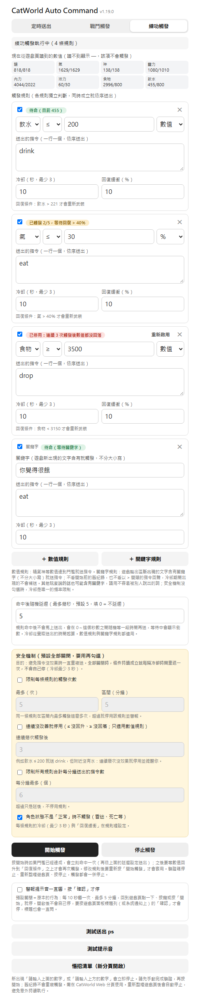

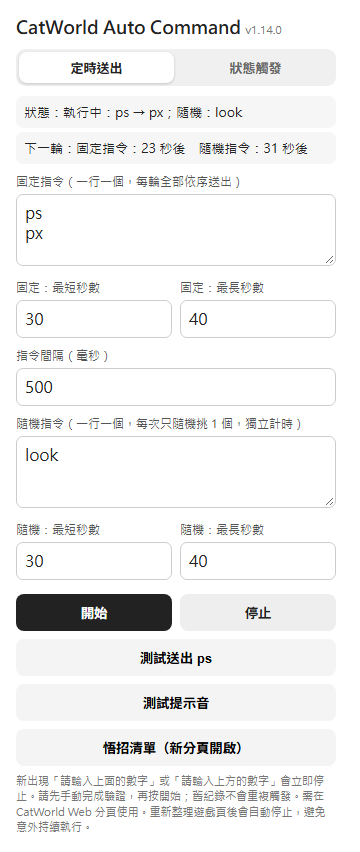

| 項目 | 說明 |
|---|---|
| 固定指令 | 一行一個，每輪全部依序送出。預設 `ps`、`px` |
| 固定：最短／最長秒數 | 每輪之間隨機等待的秒數範圍（預設 30～40） |
| 指令間隔（毫秒） | 同一輪裡兩個指令之間的間隔（預設 500） |
| 隨機指令 | 每個指令一列，各有自己的最短／最長秒數，「＋ 新增隨機指令」新增、✕ 刪除。流程：先從所有隨機指令裡**均勻隨機挑一個**，再在**它自己的**秒數範圍內隨機等一段時間，到時間才送出，送出後再挑下一個。每個指令被挑中的機率一樣，秒數只決定「挑中它之後要等多久」（例如 `look` 5～10 秒、`sleep` 60～90 秒，各一半機率被挑中）。和固定指令各自獨立計時 |
| 開始／停止 | 設定會記住。開始時會先送出一輪 |
| 測試送出 ps | 不開始自動化，只送一次 `ps`，確認輸入框抓得到 |
| 測試提示音 | 播放一次提示音。被瀏覽器擋住時請先在遊戲分頁點一下再試 |
| 悟招清單 | 在新分頁開啟各武功的悟招條件與招式表 |
| 怪物分級：綠上限、黃上限 | 怪物查詢的顏色切分點（`q` 的上限，預設 1.5 和 3），見下面的「怪物查詢」；需 1 < 綠上限 < 黃上限，不合法的值會還原 |
| 主要武器類型 | 無名物品提示用：劍、刀、杖、鞭、拳套、暗器，未設定時只依等級建議，見下面的「無名物品」 |

**浮動面板**出現在遊戲頁上，「定時」「戰鬥」「練功」各一列，各有自己的開始／停止；另有「怪物」（適合的怪、怪物出現提示）和「解謎」兩列，用法見下面的「怪物查詢」「解謎」「無名物品」三節；執行中的遊戲巨集有一列「巨集」。「定時」列顯示倒數和要執行的指令：固定指令一行（例如「固定 31 秒後：ps → px」）、隨機指令一行（被挑中的那一個，例如「隨機 8 秒後：look」）；「戰鬥」「練功」列顯示規則狀態與命中後的倒數。標題列有 `⚙`（開啟／關閉設定頁）和 `–`（收合），可拖曳，不會搶走遊戲輸入框的游標。預設在右上角。遊戲自己的浮動視窗（地圖、狀態、巨集、設定）是你拖到哪就固定在哪，所以沒拖過面板時，面板會自動避開「現在看得見、而且在畫面內」的那些視窗：優先排在它們下方，放不下就排在左邊；關著的視窗和縮小視窗後跑到畫面外的視窗不算。你拖過面板就固定在你放的位置，不再自動移動。紅點表示因驗證碼而停止，或有觸發規則被停用。

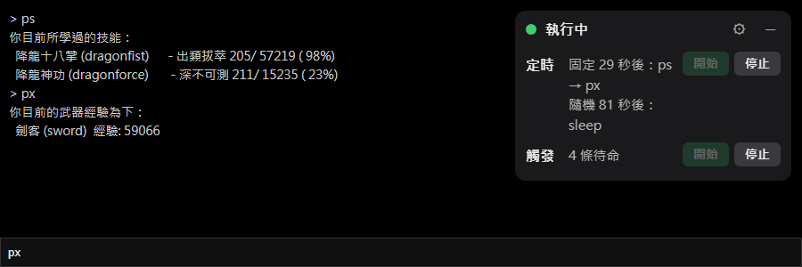

**重新整理遊戲頁會自動停止**，定時與觸發都不會偷偷繼續跑，需要再按開始。（截圖中的遊戲文字只是示意。）

## 怪物查詢

面板有一列「怪物」，資料內建（zap 攻略站的 MOB 列表、遊戲說明站的新手怪列表，加上手動補充），不用離開遊戲去查。

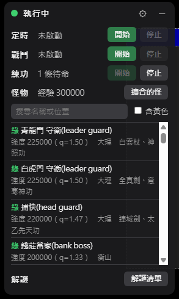

（截圖中的經驗數字只是示意。）

- **適合的怪**：按「適合的怪」，依目前經驗（讀遊戲狀態視窗的「經驗」）列出綠色的怪，強度由高到低，顯示名稱、強度、位置、備註。可以搜尋名稱或位置，勾「含黃色」連黃色一起列。經驗讀不到時顯示「讀不到經驗」。
- **怪物出現**：走進有怪物的地方，面板底部浮層顯示該怪的強度、顏色、位置與備註，10 秒後消失，不需要開始任何自動化。同房間重複的怪合併成「×數量」；同名不同地點的怪（例如老虎）列出所有候選，自己依所在地判斷；資料裡沒有的怪顯示「表上無此怪」。
- **顏色**：`q = 怪物強度 × 2 ÷ 目前經驗`。白（灰）：`q ≤ 1`，打了沒有潛能；綠：有潛能且較安全；黃：要小心；紅：差距太大。遊戲沒有公開切分點，預設綠 `q ≤ 1.5`、黃 `q ≤ 3`，在設定頁「怪物分級」調整，改了馬上生效；請對照遊戲裡怪物名稱的顏色校準。
- **補資料／更新資料**：編輯 `tools/zap-overrides.json`（以「名稱(ID)」為鍵，可補位置、備註、強度；帶 `location` 會新增同名不同地點的怪）後執行 `node tools/gen-zap-data.js`（需要連網、Node 18 以上）重新產生 `zap-data.json`。來源網站更新時也這樣重新產生。

## 解謎

面板有一列「解謎」，按「解謎清單」展開：

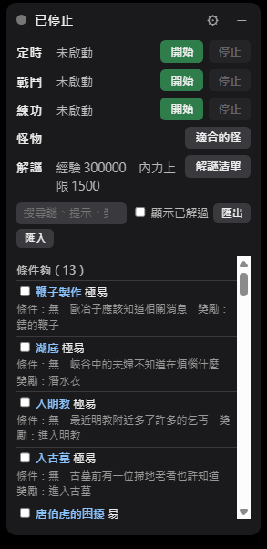 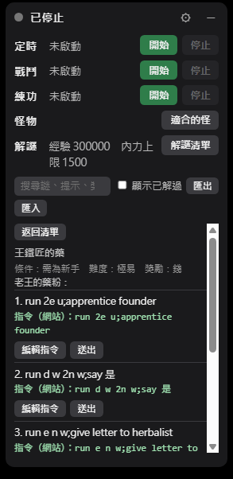

（截圖中的經驗與內力數字只是示意。）

- **三組**：依目前經驗（狀態視窗的「經驗」）與內力**上限**比對謎的條件。「條件夠」：可讀的條件都達標；「條件需自行確認」：含技能等級、天賦、需要某件物品、是否為新手、未知這類狀態視窗看不到的條件，由你自己判斷；「條件未達」：經驗或內力不夠（含 `[註]` 的謎總表說沒達到仍可解，但這裡仍歸未達）。經驗或內力讀不到（狀態視窗被關掉）時全部歸「需自行確認」。組內依難度（極易到極難）排序，可搜尋名稱、提示、獎勵，每個謎可勾「已解過」（預設隱藏，勾「顯示已解過」可看）。
- **步驟**：點清單裡的那一列（不是前面的方框，那個是「已解過」）看步驟；同一頁有好幾個謎時（石牢、入古墓、入明教等）只顯示你點的那個謎自己的那一段，可按「顯示整頁步驟」看整頁。從醉仙樓客棧出發的路徑會提示先 `recall` 再送出。第一步之前的準備事項和步驟之間的小標題（例如「入古墓：」）也會顯示。網站上抽得出指令的步驟顯示指令，其餘步驟只有文字（約七成以上）：抽取很保守，一步裡只要有任何一段看不懂（移動寫在說明文字裡、ask 被截斷、兩個指令黏在一起）就整步不給指令，請自己補。沒有編號步驟的頁（屠龍刀、拜師表、六脈神劍）顯示整頁文字。認不出分段的共用頁（例如玉蕭劍法與彈指神通）步驟是整頁共用的。
- **送出**：每步的「送出」把那一步顯示的指令（`;` 分隔）送進遊戲，走和巨集一樣的佇列（可寫 `@等待 3`；出現驗證碼會取消，面板「巨集」列有停止鈕），一次只送一步。步驟裡的 `run` 路徑照網站原樣，不會補 `run e 5n 2o`。
- **補指令**：「編輯指令」填的指令存在本機瀏覽器，優先於網站；清空或按「還原」回到網站的內容。資料更新後若該頁的步驟數和你補某一步的時候不同，那一步會標示「步驟已變動，請確認」（每個補過的步驟各自判斷）。多個遊戲分頁的補充指令與已解過標記會同步。「匯出」把補的指令和已解過標記複製成 JSON，「匯入」貼回還原（格式不對時不會動既有資料）。
- 資料來自 zap 攻略站的解謎總表與步驟頁，和怪物資料同一個內建檔，更新方式相同（`node tools/gen-zap-data.js`）。攻略站的指令不保證正確，送出前請看清楚。

## 裝備比較

鑑定出來的裝備（找長安鑑定屋的馬鑑定師，下 `identify`）要不要留，面板會幫你和**現在穿的同類別裝備**比。

1. **先按「裝備」列的「讀取目前穿著」**：會送 `i`，再對每件穿著的裝備各送一個 `view`（約 12 個唯讀指令，走和巨集一樣的佇列，出現驗證碼會停），把每件的數值存在本機當比較的基準。換裝之後請再按一次；你自己 `view` 身上的裝備時，那一件也會自動更新。鑑定的時候**不會**送任何指令。
2. **去鑑定一批裝備**：面板底部浮層的「鑑定裝備」區段，每件一行，標出「比現在好，建議留下」「比現在差」「相當」或「沒有基準可比」，後面寫理由與比的對象、基準是幾分鐘前讀的。需求經驗比你現在高的會加註「你還不能穿」。
3. **規則**：只比同類別（披風比披風、盔甲比盔甲，武器只和同一種武器比）。先比傷害力／防禦力，相差 3 以上以高的為準；差不多再比屬性分數：和你**主要武器類型**（設定頁選）相關的屬性（攻擊，加上劍術、棒法、拳腳等）每點 2 分，其他正向屬性每點 1 分，負的照扣，重量、硬度、潛能不計分。同類別穿了好幾件（兩枚戒指）時和最弱的那一件比，所以不會把比較差的標成比較好。
4. **限制**：這些分數與「差 3 以上」是猜測，要依你實際的感覺調整；頭盔、腰帶、鞋子等類別沒有輸出樣本，讀不懂的區塊會讀不到、不給比較結果；沒有先讀取目前穿著就是「沒有基準可比」。

## 無名物品

把無名雜物拿給衰老頭鑑定、拿到真名時（遊戲出現「衰老頭給你…」），面板底部浮層會顯示「鑑定結果」，和怪物提示共用同一個浮層，10 秒後消失。

- **建議**：LV1、LV2 建議賣掉，LV3 以上建議留著；和你的主要武器類型相關的鑄模與材料不論等級都標「適合你，建議留著」。表上沒有的物品顯示「表上沒有這個物品」，不給建議。
- **主要武器類型**：在設定頁選（劍、刀、杖、鞭、拳套、暗器），改了馬上生效。相關與否只看攻略表上實際有的詞：劍鑄模、刀鑄模、杖鑄模、鏢鑄模（暗器）、含「鞭」的材料；表上沒有任何拳套相關物品，所以選拳套不會出現「適合你」。沒有武器字的材料（例如千年雪蛛岩）只依等級建議。
- **只在鑑定當下提示**：要先看到「你拿著…給衰老頭看了一下」才會處理後面的「衰老頭給你…」；背包清單、鑑定後的裝備（武器、防具）都不處理。
- 資料來自 zap 攻略站的無名物品表，和怪物資料同一個內建檔，更新方式相同（`node tools/gen-zap-data.js`）。要修正某個物品或補上沒有的物品，在 `tools/zap-overrides.json` 加一項 `{ "item": "物品名稱", "level": 3, "weapon": "劍", "note": "說明" }`：名稱對得上就覆蓋有寫的欄位，對不上就新增（新增必須有 `level`，1～5）；`weapon` 只能是劍、刀、杖、鞭、拳套、暗器或空字串。

## 遊戲巨集的等待（`@等待`）

遊戲自己的「巨集／快速鍵」視窗，把指令用 `;` 隔開，按下按鍵時**一次全部送出**，遊戲本身沒有等待。在巨集的指令裡加一段 `@等待 秒數`，就能在指令之間等一下：

```
eat;@等待 3;drink          送 eat，等 3 秒，再送 drink
hp ; @wait 2-5 ; sc        送 hp，等 2～5 秒（隨機），再送 sc
```

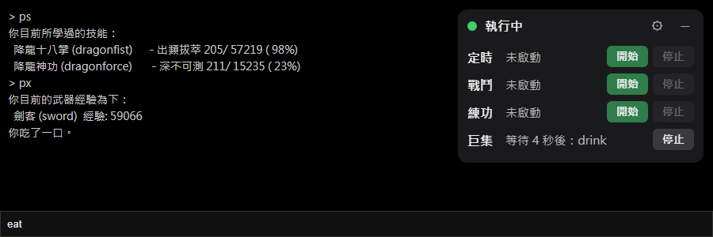

- **寫法**：`@等待 3`、`@wait 3`、範圍 `@等待 3-6`（隨機）、小數 `@wait 0.5~1.5`，後面可以加「秒」或 `s`；每次最多 600 秒；一個巨集裡可以有很多段。
- **運作方式**：extension 在遊戲處理按鍵**之前**攔下「有 `@等待` 的巨集」，自己照順序執行：送出前面的指令、等待、再送後面的。沒有 `@等待` 的巨集完全交給遊戲，不受影響。
- **寫錯整個不執行**：`@等待 abc`、最短大於最長、超過 600 秒，因為已經攔下按鍵，不會只送出一半，整個巨集都不執行，面板的巨集列顯示原因 8 秒。
- **等待時不擋住別的功能**：指令走同一個送出佇列，定時、觸發、關鍵字的指令可以插進來，也遵守「指令間隔」。如果你的巨集一定要連續執行，別讓其他功能同時在跑。
- **面板的「巨集」列**：有巨集在跑才出現，顯示「等待 N 秒後：下一個指令」和**停止**鈕；同時有兩個以上會標註個數。
- **按住不放**：只啟動一次。
- **驗證碼**：巨集執行中也會偵測。出現驗證碼會立即停止，後面還沒送的指令作廢。驗證碼停止後再按有 `@等待` 的巨集鍵，視為你已經處理好驗證，會重新開始偵測並照常執行（和按「開始」一樣）。
- **只在遊戲認得的情況下才處理**：焦點在指令輸入框或網頁本身時（和遊戲處理巨集的條件一樣），按鍵要是遊戲巨集能用的組合。
- **你正在輸入的文字不會被洗掉**：extension 代送指令後，會把輸入框裡你原本打到一半的文字和選取範圍還原（這也適用定時、觸發、關鍵字送出的指令）。
- **注意**：extension 沒裝、被關掉，或遊戲頁沒重新整理時，`@等待 3` 會被當成一般指令原樣送給遊戲。

## 巨集備註

遊戲「巨集／快速鍵」視窗的每一列最右邊多了一欄**備註**，可以寫這個巨集是做什麼的（視窗會被加寬，從 435px 變成約 690px）。

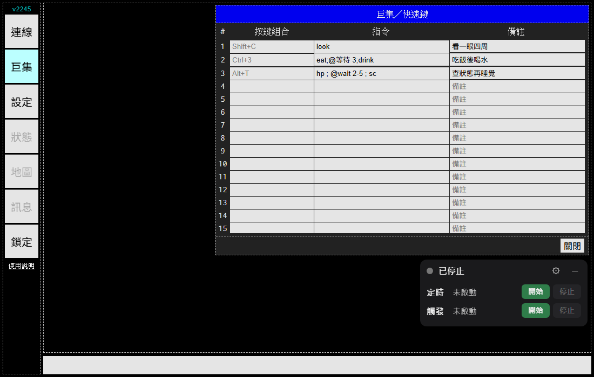

- **綁在列號上**（最左邊的 #），不是綁按鍵組合，所以你改按鍵組合，備註還在同一列。清空備註就是刪掉。
- **只存在這個 extension**（瀏覽器的本機儲存），**不會被送到遊戲**，也不在遊戲自己的巨集備份、匯出裡；不會跟著 Chrome 帳號同步，換瀏覽器、換電腦、清掉 extension 的資料就沒了。同一個瀏覽器開多個遊戲分頁時，備註會即時同步。
- **不影響巨集**：在備註欄打字不會觸發巨集；遊戲讀巨集的方式也完全不變（`@等待` 照常運作）。
- 輸入後約 0.3 秒自動存，離開那一格會立刻存，不需要按任何按鈕。
- 巨集視窗加寬後如果超出畫面，把視窗標題列拖動一下就好。

## 狀態觸發（戰鬥觸發／練功觸發）

觸發分成**戰鬥觸發**和**練功觸發**兩個分頁，功能完全一樣、設定與開關**完全獨立**：各有自己的規則、開始／停止、命中後延遲、安全機制與冷卻，可以只開其中一個，也可以同時開。例如戰鬥觸發放「氣 ≤ 30％ → exert recover」，練功觸發放「飲水 ≤ 200 → drink」。兩組同時在跑時，指令仍走同一個送出佇列（遵守指令間隔）。驗證碼出現時兩組（和定時）一起停。從舊版升級時，原本的狀態觸發規則整份放進「練功觸發」，「戰鬥觸發」是空的。下面的說明對兩個分頁都適用。

有兩種規則：**數值規則**和**關鍵字規則**（見下面「關鍵字規則」一節）。數值規則讀遊戲頁右下角即時狀態區塊（`#monitor`）的八項數值：精、氣、神、靈力、內力、法力、食物、飲水。**目前值達到你設的門檻**（可選「小於等於」或「大於等於」，兩者都包含等於）就送出指令，並內建防止無限執行的機制。在 popup 的「戰鬥觸發」或「練功觸發」分頁設定。

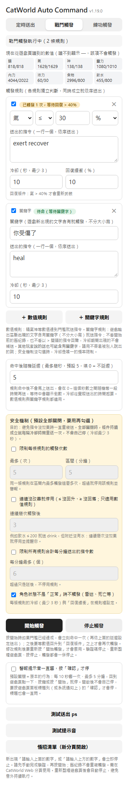 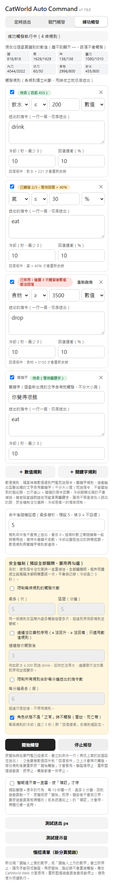

每條規則：

| 欄位 | 說明 |
|---|---|
| 項目、方向與門檻 | 八項之一；方向選 `≤`（目前值小於等於門檻，例如飲水太低就喝水）或 `≥`（目前值大於等於門檻，例如食物太滿就處理掉）；單位可選「數值」或「％」（目前值除以上限） |
| 送出的指令 | 一行一個，條件成立時依序送出 |
| 冷卻（秒） | 同一條規則兩次觸發之間至少隔多久，預設 10，最少 3 |
| 回復緩衝（％） | 見下面「回復條件」，預設 10 |

- 各規則獨立判斷，同時成立就依序排進送出佇列（和定時共用，間隔同「指令間隔」）。
- 畫面上方「現在從遊戲頁讀到的數值」會即時顯示讀到的目前值／上限；顯示 `—` 表示讀不到，該項規則不會觸發。
- 精、氣、神的上限讀 `eff_*`（有效上限，`max_*` 是百分比）；靈力、內力、法力、食物可以超過上限（例如 1080 / 1010），所以預設用「數值」比較。
- 修改規則後要重新按「開始觸發」才會套用。規則設定會記住，開關不會記住。

### 觸發的流程（為什麼不會一直重複）

1. 按「開始觸發」時，如果條件已經成立，**立刻命中一次**（再依「命中後延遲」決定什麼時候真的送出）。
2. 觸發後進入「等待回復」。數值要越過**回復條件**才會重新武裝：`≤` 規則要回升到回復條件之上，數值模式是 `門檻 ×（1 + 緩衝％）`，％模式是 `門檻 + 緩衝個百分點`；`≥` 規則方向相反，要回落到回復條件之下，數值模式是 `門檻 ×（1 − 緩衝％）`，％模式是 `門檻 − 緩衝個百分點`。每條規則下方會顯示算出來的回復條件。
3. 冷卻結束後如果數值**仍然達到門檻**，會比較「現在」與「上次觸發當下」的值：往好的方向走算有效（`≤` 規則是回升，`≥` 規則是回落），否則算「無效」。如果勾選了「連續沒改善就停用」且無效次數達到上限，就停用該規則；否則再送一次。
4. 數值在門檻與回復條件之間時不動作，等回復。
5. 精、氣、神本來就會自然恢復，「有沒有改善」的判斷對它們比較不準。

規則旁的標籤：「待命」（隨時可觸發）、「已觸發 N/上限，等待回復 > X」、「已停用：原因」（旁邊有「重新啟用」）。

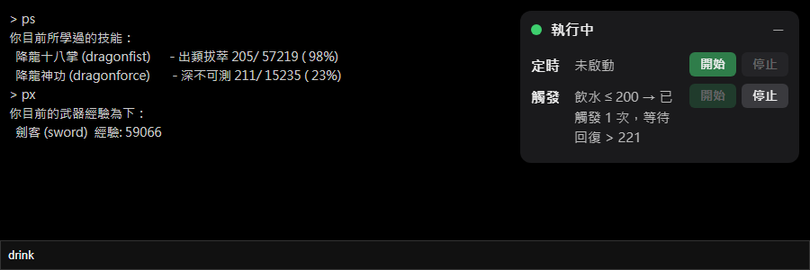

### 命中後延遲

規則命中後**不會馬上送出**，會在 **0～N 秒之間隨機**等一段時間再送，N 預設 5，填 0 就是不延遲。這個設定在各自的觸發分頁，該分頁的所有規則共用，數值規則與關鍵字規則都適用。

- 等待中，面板的「戰鬥」「練功」列會顯示倒數**和要執行的指令**，例如「飲水 ≤ 200 → 3 秒後：drink」（多條規則同時在等，每條一行；指令有多個時用 → 連起來）；popup 該規則旁的標籤顯示「命中，3 秒後執行：drink」。
- 命中的當下就算一次觸發（次數上限、每分鐘上限都在這時計入），**冷卻從實際送出的時間起算**；延遲期間規則不會重複命中。
- 延遲期間按「停止觸發」、出現驗證碼、重新整理遊戲頁，還沒送出的指令都會作廢。
- 到時間時如果角色狀態不是「正常」（預設會擋），這一次就略過。
- 送出時間以每秒一次的判斷為單位，所以實際送出最多比預定晚 1 秒。
- 舊的設定沒有這個欄位，也會用預設的 5 秒。

### 關鍵字規則

popup 的規則清單下方有兩顆新增按鈕：「＋ 數值規則」（上面介紹的）和「＋ 關鍵字規則」。關鍵字規則是：**遊戲輸出區新出現的文字含有關鍵字，就送出指令**。例如關鍵字 `你覺得口渴`、指令 `drink`。

| 欄位 | 說明 |
|---|---|
| 關鍵字 | 新出現的文字含有這段字就觸發，不分大小寫，比對時忽略換行與空白（遊戲硬斷行的句子也對得到），不是正規表示式 |
| 送出的指令 | 一行一個，依序送出 |
| 冷卻（秒） | 觸發後這段時間內出現的關鍵字**直接丟掉**，預設 10，最少 3 |

它和數值規則共用同一組開始／停止、冷卻下限、安全機制與驗證碼停止。為了避免「指令的回覆又含關鍵字，造成一直重複觸發」的迴圈，有這幾個規則：

- **只看新出現的文字**：按「開始觸發」時不會掃描舊紀錄，也不會一開始就觸發（和數值規則不同）。
- **冷卻期間的關鍵字直接丟掉，不補送**：回覆又含關鍵字時，冷卻結束後沒有新的關鍵字文字就不會再觸發，迴圈就在這裡斷掉。
- **以 `>` 開頭的行是指令回聲**，整行略過，所以關鍵字和指令相同（例如都是 `drink`）也不會被自己的回聲觸發。
- 只比對遊戲輸出區（`#content`）。地圖、狀態、巨集、設定這些遊戲視窗的更新不算。
- 同一批新文字裡有驗證碼時，先停止、不送指令，不會比對關鍵字。

注意：
- **其他玩家說的話也可能含有關鍵字**，等於別人能讓你的角色執行指令。請用不容易被別人說出的詞，指令也不要放危險的。
- 安全機制沒勾選時，冷卻是關鍵字規則唯一的頻率限制。「連續沒改善就停用」不適用關鍵字規則（沒有數值可以比較），「限制觸發次數」和「限制每分鐘指令數」適用。
- 遊戲若把一句話拆成多批輸出，關鍵字跨批會比對不到；顏色標記造成的拆分在同一批裡不受影響。
- 角色狀態不是「正常」時（預設會擋），關鍵字也會被忽略。如果你的關鍵字是「你昏倒了」之類，要取消那個勾選。

### 安全機制（三道限制預設全部關閉，要用再勾選）

**全部關閉時，條件持續成立就每隔冷卻時間重送一次，不會自己停**（冷卻最少 3 秒，這一條不能關）。例如飲水 ≤ 200 就送 `drink`，但附近沒有水，指令會一直重送。需要保護時再勾選下面的限制：

| 設定 | 勾選後的作用 | 數字（預設值） |
|---|---|---|
| 限制每條規則的觸發次數 | 同一條規則在區間內觸發超過上限，就**停用該規則**並警報 | 5 次 / 5 分鐘 |
| 連續沒改善就停用 | 連續這麼多次觸發後數值都沒往好的方向走，就**停用該規則**並警報 | 3 次 |
| 限制所有規則合計每分鐘送出的指令數 | 超過只是延後，不停用。單條規則一次要送的指令數超過這個數字，該規則會被停用 | 6 個 |

沒勾選的限制，旁邊的數字欄位會反灰。另外兩項設定一直有效：

| 設定 | 預設 | 作用 |
|---|---|---|
| 角色狀態不是「正常」時不觸發 | 開（可取消勾選） | 昏迷、死亡等不送。讀不到 `#status` 也不送 |
| 冷卻（每條規則） | 10 秒（最少 3） | 不能設成 0 |
| 回復緩衝（每條規則） | 10％ | 避免數值在門檻附近上下跳動時反覆觸發 |

另外：元素不存在、不是數字、％模式上限為 0 時，該規則不觸發。

### 停止與警報

- 某條規則被停用（只會發生在你勾選了對應的限制時）：響一次提示音、標題閃爍「⚠ 觸發已停用」、跳桌面通知；其他規則與定時照常。面板顯示「觸發已停用 N 條」，popup 該規則旁出現「重新啟用」。這種情況**不是**驗證碼，不會把整個自動化停掉。
- 驗證碼偵測在定時或觸發任一個執行時都作用。出現驗證碼會**定時與兩組觸發一起停**，之後不再送出任何指令。
- 定時、戰鬥觸發、練功觸發三者的開始／停止互不影響。
- 觸發送出指令後，8 秒內遊戲沒有任何新內容，同樣視為疑似驗證碼而停止（和定時一樣）。
- `#monitor` 的數值更新不算遊戲回覆，不會干擾上面這個 8 秒判斷。

## 驗證碼：什麼時候停

定時送出或狀態觸發任何一個在執行時，都會偵測。以下任一情況成立就**立刻停止並警報**：

| 觸發 | 時機 |
|---|---|
| 文字提示：`請輸入上面的數字`／`請輸入上方的數字` | 這段文字出現在遊戲內容的瞬間 |
| 圖形驗證碼（`@ $ # % & *` 字元圖，或彩色背景區塊組成的圖） | 圖形出現的瞬間：連續 5 行以上都是同一種符號 |
| 雜訊型驗證碼（一大塊英數字與色塊混合） | 連續 8 行以上、每行至少 30 字且含色塊時 |
| 無回應（兜底） | 送出指令後 **8 秒**內，遊戲沒有出現任何新的內容（自己送出的指令回顯不算） |

前三項看的是「新出現」的內容，舊的歷史紀錄不會重複觸發。

### 停了之後發生什麼

- 定時與觸發立即一起停止，計時取消，**之後不會再送出任何指令**（包含「測試送出」），直到你重新按開始。
- 馬上響一次提示音，之後**每 10 秒再響一次**。要響多久，看 popup 最下面的開關「警報提示音一直響，按『確認』才停」（見下面）。
- 分頁標題閃爍「⚠ 需要驗證」，並跳出桌面通知（點通知會切回遊戲分頁）。
- 浮動面板變紅，顯示停止原因。
- **開關「警報提示音一直響，按『確認』才停」**（popup 裡，預設**關閉**，改了馬上生效，不用重新整理遊戲頁）：

  | | 關閉（預設，原本的行為） | 開啟 |
  |---|---|---|
  | 提示音 | 每 10 秒一次，**最多 5 分鐘** | 每 10 秒一次，**沒有時間上限** |
  | 怎麼停 | 回到遊戲頁（切到該分頁、點一下、按鍵）或按「開始」就停；標題閃爍也一樣 | **只有按「確認」才停**（點頁面、按鍵、按「開始」都不會停）；標題也一直閃到確認 |
  | 「確認」在哪 | 沒有這顆按鈕 | 遊戲頁面板標題列的紅色「確認」（面板收合時也看得到），標籤會顯示「・響鈴中」；系統通知上也有「確認（停止提示音）」按鈕 |

  按「確認」會同時停掉提示音與標題閃爍。「規則被停用」這類提醒只響一次，不受這個開關影響。

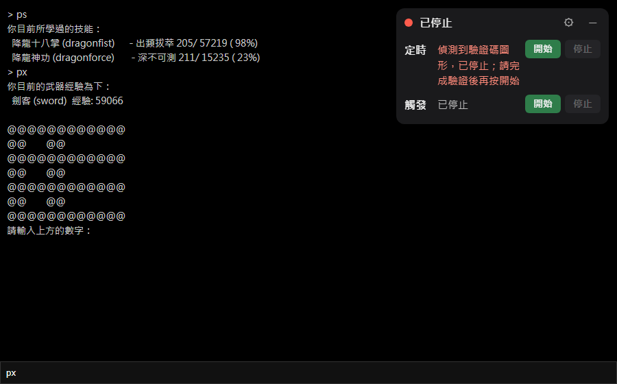

### 怎麼繼續

1. 回到遊戲頁，**自己**輸入驗證碼完成驗證（本 extension 不會自動辨識或輸入驗證碼）。
2. 看到驗證成功後，按浮動面板或 popup 的「開始」（定時）或「開始觸發」。

## 常見問題

- **觸發分頁的數值格都是 `—`**：確認目前分頁是 CatWorld Web 遊戲頁，並且重新整理過。遊戲若改了即時狀態區塊的欄位 id（`gin`、`water` 等），就會讀不到，請回報。這個功能我只用模擬的 `#monitor` 測過，還沒有在真實遊戲頁上驗證過數值更新的頻率與格式。
- **關鍵字規則沒反應**：關鍵字要出現在遊戲輸出區的「新」文字裡；按開始前就存在的紀錄、你自己輸入的指令回聲（`>` 開頭）都不算。冷卻期間（預設 10 秒）出現的也不算。確認關鍵字和遊戲文字一字不差（空白、標點也要一樣；不分英文大小寫）。
- **觸發規則被停用**：只有勾選了安全機制才會。多半是指令沒有讓數值往好的方向走（例如沒水可喝，飲水一直沒回升）。先到遊戲裡手動確認指令有效，再按規則旁的「重新啟用」；嫌太容易停用就取消勾選，或把數字調大。
- **指令一直重送停不下來**：安全機制預設全關，條件持續成立就會每隔冷卻時間重送。按「停止觸發」，並勾選「連續沒改善就停用」或「限制觸發次數」。
- **提示音沒響**：瀏覽器在你還沒跟該分頁互動前會擋住聲音。開始自動化前先在遊戲頁點一下，並用「測試提示音」確認有聲音。
- **桌面通知沒出現**：確認系統（Windows 的專注／勿擾模式、macOS 的專注模式）與 Chrome 沒有關掉通知。就算通知被擋，提示音、標題閃爍與面板仍會運作。
- **沒有驗證碼卻停了**：面板會寫停止原因。若是「8 秒沒有收到遊戲回應」，通常是網路卡頓或遊戲沒回覆該指令；若是「偵測到驗證碼圖形」但畫面上不是驗證碼，請把那段遊戲輸出回報，調整偵測規則。
- **驗證碼出現卻沒停**：圖形偵測以「同一批新增的內容」為單位，若遊戲一行一行分批印出，可能不會當場命中，最晚由 8 秒無回應的兜底停下。請把那段輸出回報。

## 為什麼最後一步要手動

Chrome 沒有給程式靜默安裝未上架 extension 的正式管道，近年的正式版也限制了命令列載入 extension 的旗標，所以安裝腳本只負責「把最新檔案放到固定位置並引導你載入」。

## 其他安裝方式

### 已經有 Node.js 與 git：npx

```sh
npx github:austinchen705/chrome-extensions
```

參數 `--dir <路徑>` 指定資料夾、`--no-open` 不開 `chrome://extensions`。更新時重跑同一行；若顯示的版本號沒變，是 npx 用了快取的舊版，到 `npm config get cache` 顯示的資料夾，刪掉 `_npx` 底下 `package.json` 含 `austinchen705/chrome-extensions` 的那個資料夾再重跑。

沒有 Node.js 與 git 時：

```sh
# Windows（PowerShell）
winget install OpenJS.NodeJS.LTS
winget install Git.Git

# macOS
brew install node
xcode-select --install
```

裝完關掉再重開終端機，用 `node -v`、`npx -v`、`git --version` 確認（Node 16.7 以上）。

### 完全手動

到 GitHub 下載 repo 的 ZIP，解壓後在 `chrome://extensions` 用「載入未封裝項目」選 `catworld-auto-command` 資料夾。更新時重新下載並覆蓋舊資料夾，再按「重新載入」。
